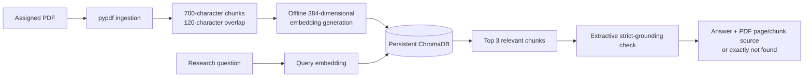
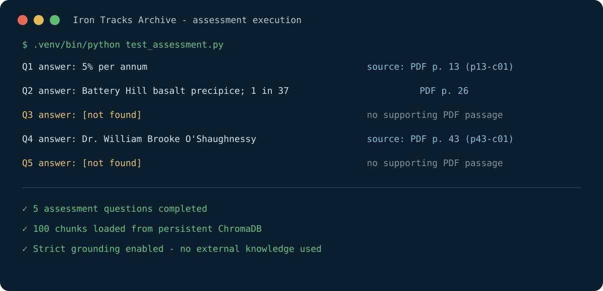

# Iron Tracks Archive - Modern History RAG Assistant

A strict, source-bounded Retrieval-Augmented Generation (RAG) system for the assigned 50-page monograph, *Iron Tracks & Copper Wires: Archival History of 19th-Century Indian Railways & Telegraphs*.

The assistant answers only from the supplied PDF. If evidence is unavailable, the API returns exactly `[not found]`.

## RAG architecture and workflow



1. `ingest.py` reads all 50 PDF pages using `pypdf`.
2. It removes repeating page furniture and creates meaningful 700-character chunks with a 120-character overlap.
3. `OfflineHashEmbedding` creates deterministic 384-dimensional local vectors. It needs no API key, model download, or external knowledge.
4. Chunks, vectors, page numbers, and stable chunk IDs are saved in ChromaDB at `chroma_db/`.
5. `rag.answer(question)` retrieves the top matching chunks and extracts only source wording from them.
6. When there is insufficient support in the PDF, it returns exactly `[not found]` with an empty sources list.

## Project structure

```text
data/indian_railways_and_telegraph_history_50p.pdf  # assigned knowledge source
ingest.py                                            # ingestion, chunking, embeddings, Chroma persistence
rag.py                                               # required answer(question) function
server.py                                            # local browser API
test_assessment.py                                   # required five-question evaluation
assessment_outputs.json                              # generated assessment evidence
chroma_db/                                           # persisted local vector database
```

## Setup and execution

```bash
python3 -m venv .venv
.venv/bin/pip install -r requirements.txt

# Ingest, chunk, embed, and persist the PDF (first run only)
.venv/bin/python ingest.py

# Run the five required assessment questions
.venv/bin/python test_assessment.py

# Launch the browser demo at http://localhost:5173
npm run dev
```

No API key is required. `.env.example` documents the optional `PDF_PATH` configuration; a real `.env` is excluded from Git.

## Required interface

```python
from rag import answer

answer("Who supervised the Diamond Harbour cable?")
# {
#   "answer": "Archival Public Works dispatches confirm that Dr. William Brooke O'Shaughnessy ...",
#   "sources": ["PDF p. 43 (p43-c01)"]
# }
```

## Assessment questions: expected vs actual output

| # | Assessment question | Expected answer | Actual generated answer | Source reference |
|---|---|---|---|---|
| Q1 | What exact annual guaranteed interest rate, expressed as a percentage, did the colonial administration promise private British railway companies under the 1849 contract terms? | 5% per annum | 5% per annum, returned in the source sentence about the 1849 contract terms. | PDF p. 13 (`p13-c01`) |
| Q2 | Which engineering obstacle on the Bhor Ghat incline made the reversing station described in Chapter 3 necessary, and what was the gradient ratio? | Battery Hill's sheer basalt precipice; 1 in 37 | The assistant returns the Battery Hill basalt precipice and the 1 in 37 ruling gradient. | PDF p. 26 (`p26-c01`) |
| Q3 | What is the ticket price for an Executive Chair Car seat on the Vande Bharat Express between New Delhi and Varanasi? | `[not found]` | `[not found]` | None - not in PDF |
| Q4 | According to the archival records in the text, who supervised the laying of the experimental Diamond Harbour underwater telegraph cable in 1851? | Dr. William Brooke O'Shaughnessy | Dr. William Brooke O'Shaughnessy, returned in the archival dispatch sentence. | PDF p. 43 (`p43-c01`) |
| Q5 | Which country won the 2022 FIFA World Cup? | `[not found]` | `[not found]` | None - not in PDF |

The complete machine-generated JSON results are committed in [assessment_outputs.json](assessment_outputs.json).

## Execution output screenshot



## Technical compliance checklist

- [x] PDF ingestion from the assigned source only
- [x] Meaningful chunking with overlap
- [x] Local embedding generation
- [x] Persistent ChromaDB vector database
- [x] Strictly grounded retrieval and extractive responses
- [x] Page and chunk references for supported answers
- [x] Exact `[not found]` response for unavailable information
- [x] `.env` support with no hardcoded keys or secrets
- [x] Reloadable database without re-embedding
- [x] Required `answer(question: str) -> dict` function
